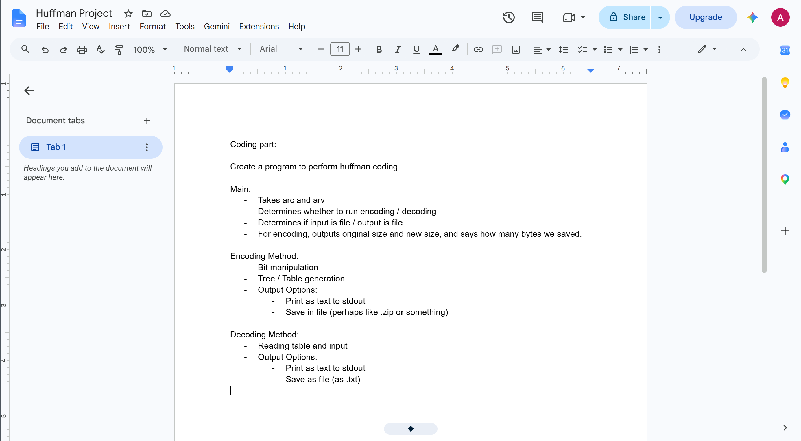

# COMP 211 Checkoff 3 - Huffman Coding

Aryan Gera

## Background

This project is for UNC's COMP 211 systems programming course, and its objective is for us to self-learn and present on a topic that interests us. We are to use AI to accelerate our learning. 

I chose the data compression topic, and specifically the huffman coding subtopic, for two main reasons. The first is because of a YouTube trilogy I recently watched from mathematical educator Grant Sanderson, also known as 3Blue1Brown. The trilogy is titled, Compression is Intelligence, and the third and final part actually just released this week (11/17/26). The second is because I remeber learning about huffman back in highschool, and I always wanted to learn more about it. 

## What I am learning

### The motivation

The following scenario is [how 3Blue1Brown introduces huffman](https://youtu.be/l6DKRf-fAAM?si=wT67peOQkL9aiK2F&t=206):

Imagine a robot on a far-away planet which we send instructions to in four directions, `UP`, `DOWN`, `LEFT`, and `RIGHT`. The key thing to note is that all events aren't of equal probability. We send `UP` 1/2 of the time, `DOWN` 1/4 of the time, `LEFT` 1/8 of the time, and `RIGHT` 1/8 of the time: 

| Event $E$ | Probability $P(E)$ |
| :-: | :-: |
| `UP` | 1/2 |
| `DOWN` | 1/4 |
| `LEFT` | 1/8 |
| `RIGHT` | 1/8 |

The naive approach would be to simply use 2-bits for each one of 4 events. This way, when the robot recieves the encoded string, it can simply read chunks of 2-bits and know what moves to perform. 

This approach uses:

$$
(2 \text{ bits} \times P(\text{UP})) + (2 \text{ bits} \times P(\text{DOWN})) + \\
(2 \text{ bits} \times P(\text{LEFT})) + (2 \text{ bits} \times P(\text{RIGHT})) = \\
2 \text{ bits per event on average}
$$

However, this approach is not optimal. The inefficiency with this approach is that it doesn't take the probabilties of each event into account. That is where huffman, and many other compression algorithms come in.

### Huffman Coding

The basic idea behind huffman coding, in the context of strings, is that characters that appear more frequently should require less bits to be represented. Or, in general contexts, events that appear with higher probabilities should require less information to be represented. 

## Coding

### Design Decisions

Coding up a project like this involves having a clear understanding of what I wanted to learn and desmonstrate. I started by brain dumping what I wanted and how I wanted things to be:

To summarize, I wanted to have one program, which depending on the arguments passed in, could either encode or decode a given input. Originally, I wanted file support as well, but I realized that would complicate the scope of the project beyond what I wanted to learn and demonstrate. 

While chatting with AI and learning about how Huffman is implemented, I ran into a few design decisions that I had to make.

Firstly, when popping the two elements of minimum priority, I had to decide between a minimum priority queue (min-heap) or a two-queue method:
- Using the Min-Heap
- Using the Two-Queue Method

The second issue I ran into was how to even represent a tree in C. After some research, I found that there are two main methods of doing so:
- Struct pointers method 
    - more intuitive
    - but memory is all over the place, having to deal with mallocs and frees
- In-place nodes array 
    - less intuitive
    - but memory is contiguous, and easier to manage

My original thought was to use the more intuitive, struct pointers method, but after discussing with AI, I realized that the in-place node array method was more efficient and easier to manage for the following reasons. Firstly, for huffman, the number of nodes in the tree is always $2n - 1$, where $n$ is the number of events or characters. This means we know beforehand exactly how many nodes we will need, so there is no reason to mess with mallocs and frees. Secondly, since we are building the tree from the bottom up, we don't have to worry about moving child pointers around, which was the main benefit of using the struct method in the first place. 

